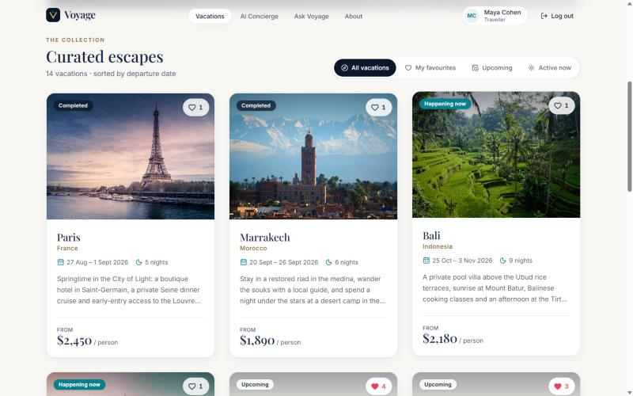
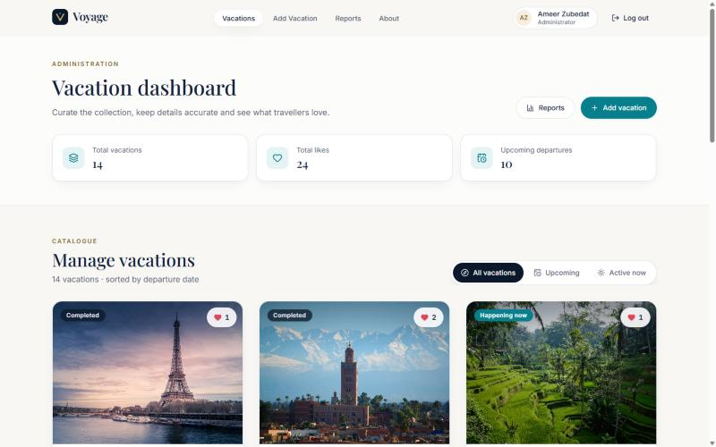
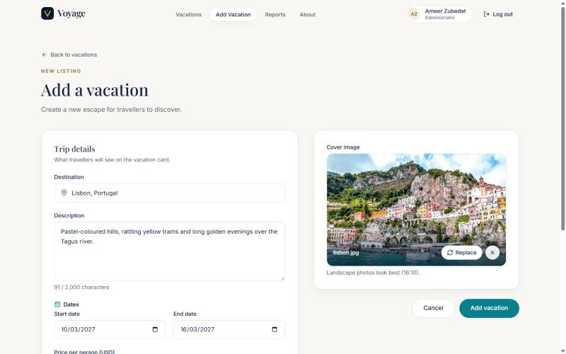
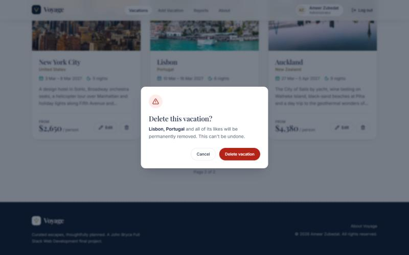
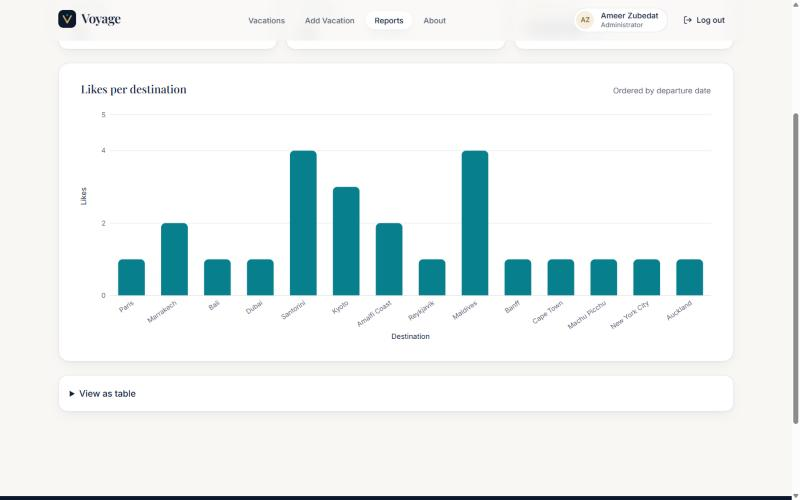
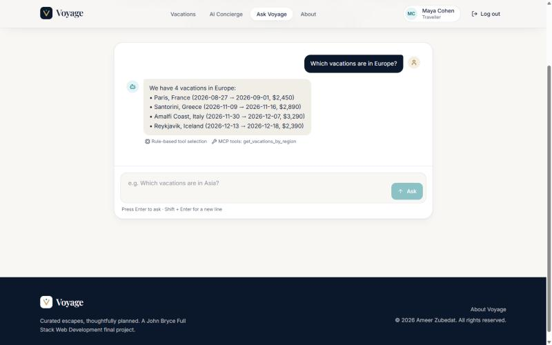
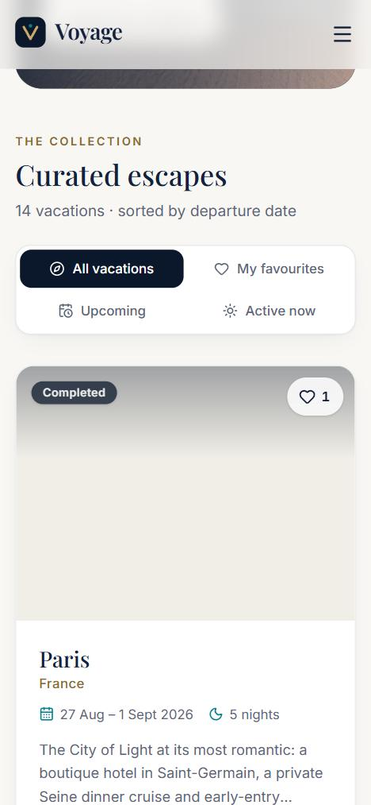
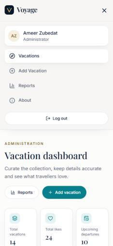

# Voyage — Premium Vacation Management Platform

> John Bryce Full Stack Web Developer — final project · **Ameer Zubedat**

Voyage is a full-stack vacation platform. Travellers browse a curated catalogue, save favourites, get AI travel recommendations and ask questions answered by a real **Model Context Protocol (MCP)** server. Administrators manage the catalogue, upload images, and analyse likes with a chart and a CSV export.


---

## Contents

- [Features](#features)
- [Technology stack](#technology-stack)
- [Architecture](#architecture)
- [Project structure](#project-structure)
- [Quick start (Docker)](#quick-start-docker)
- [Local development](#local-development)
- [Environment variables](#environment-variables)
- [Database & seeding](#database--seeding)
- [Demo credentials](#demo-credentials)
- [API reference](#api-reference)
- [MCP server](#mcp-server)
- [AI configuration](#ai-configuration)
- [Reports & CSV export](#reports--csv-export)
- [Testing](#testing)
- [Security](#security)
- [Screenshots](#screenshots)
- [Troubleshooting](#troubleshooting)
- [Publishing to GitHub](#publishing-to-github)

---

## Features

**Everyone**
- Register (first name, last name, email, password ≥ 4 characters; unique email) and log in with JWT.
- Public **About** page.

**Travellers (role `USER`)**
- Vacation catalogue as a responsive card grid (3 / 2 / 1 columns) sorted by **start date ascending**, **9 per page**.
- Each card shows the destination, image, dates, description, price and like count, with a **like / unlike** heart (optimistic UI that rolls back on error and reconciles with the server count).
- Filters: **All**, **My favourites**, **Upcoming** (not started) and **Active now**. Filtering is applied in the database *before* pagination, and changing a filter resets to page 1. Filter and page live in the URL.
- **AI Concierge**: overview, attractions, activities, a day-by-day itinerary and tips for any destination (live Claude API, structured output).
- **Ask Voyage**: natural-language questions answered through MCP tools over live MongoDB data.

**Administrators (role `ADMIN`)**
- Dashboard with live totals (vacations, likes, upcoming departures) plus the management grid. Admin cards show **Edit / Delete** and the like count, with no like button.
- **Add vacation**: all fields required, price > 0 and ≤ 10,000, end date not before start date, start date not in the past, and an image (JPEG/PNG/WebP, ≤ 5 MB) with preview.
- **Edit vacation**: the form is prefilled and shows the current image. Replacing the image is optional; the same validation applies.
- **Delete** with a confirmation dialog. Cancel keeps the vacation; confirm deletes it, its likes and its image file, and the grid updates immediately.
- **Reports**: bar chart of likes per destination (including zero-like vacations) and an Excel-ready **CSV** export (`Destination,Likes`).

**Quality**
- Role checks are enforced on the **server**; the client only mirrors them.
- Responsive from 390 px to 1440 px+, keyboard accessible, visible focus states, reduced-motion support, and skeleton, empty and error states throughout.

## Technology stack

| Layer      | Technologies |
| ---------- | ------------ |
| Frontend   | React 18, TypeScript (strict), Vite, React Router, TanStack Query, Axios, React Hook Form + Zod, Tailwind CSS v4, Recharts, Lucide icons, Framer Motion |
| Backend    | Node.js, Express 5, TypeScript (strict), MongoDB + Mongoose, JWT, bcrypt, Multer, Zod, Helmet, express-rate-limit |
| AI & MCP   | Anthropic Claude API (`@anthropic-ai/sdk`), official MCP TypeScript SDK (`@modelcontextprotocol/sdk`) over Streamable HTTP |
| Testing    | Vitest, Supertest, Testing Library, jsdom |
| Ops        | Docker, Docker Compose, nginx |

## Architecture

```
            ┌─────────────────────────┐
 Browser ──▶│ frontend (nginx :8080)  │  static React build
            │   /api/* ──proxy──┐     │
            └───────────────────┼─────┘
                                ▼
            ┌─────────────────────────┐     MCP client (Streamable HTTP)    ┌────────────────────────┐
            │ backend (Express :4000) │ ──────────────────────────────────▶ │ mcp (MCP server :4001) │
            │ auth · vacations · likes│                                     │ 6 read-only tools      │
            │ reports · AI · /mcp/ask │ ──▶ Anthropic API (if configured)   └───────────┬────────────┘
            └───────────┬─────────────┘                                                 │
                        ▼                                                               ▼
                 ┌──────────────┐   uploads volume (images)                     same MongoDB
                 │ mongo :27017 │◀──────────────────────────────────────────────────────┘
                 └──────────────┘
```

- **Layers**: `routes → middleware (auth, role, validation, upload) → controllers → services → models`. Errors flow to one central error handler that returns `{ success: false, error: { message, details? } }`. Successful responses are `{ success: true, data }`.
- **MCP**: the MCP server is a separate process and container. The backend is a genuine MCP **client**: it lists and calls tools over the protocol and never queries MongoDB directly to answer questions.

## Project structure

```
VacationManagement/
├── Backend/
│   ├── src/
│   │   ├── config/        env (Zod-validated) & DB connection
│   │   ├── models/        User, Vacation, Like (Mongoose)
│   │   ├── validators/    Zod request schemas
│   │   ├── middleware/    auth (JWT + roles), validate, upload (Multer), errorHandler
│   │   ├── services/      auth, vacations, likes, reports, ai/*, mcpQuestionService
│   │   ├── controllers/   thin HTTP adapters
│   │   ├── routes/        REST routes + rate limits
│   │   ├── mcp/           MCP server, HTTP & stdio entry points, client, data access, regions
│   │   ├── seed/          repeatable seed, seed data, DB export
│   │   └── utils/         AppError, CSV, dates, http helpers
│   ├── tests/             Vitest + Supertest API, MCP and AI tests
│   ├── seed-images/       photos for the seed vacations
│   ├── postman/           Postman collection
│   └── Dockerfile
├── Frontend/
│   ├── src/
│   │   ├── components/    VacationCard, Navbar, forms, ui/* (Button, Field, Modal, Pagination…)
│   │   ├── pages/         Login, Register, Vacations, Add/Edit, Reports, AI, Ask, About, 404
│   │   ├── layouts/       MainLayout, AuthLayout
│   │   ├── hooks/         TanStack Query hooks (list, like toggle, save, delete)
│   │   ├── services/      Axios client + API modules
│   │   ├── context/       Auth & Toast providers
│   │   ├── types/ utils/ styles/ assets/ tests/
│   ├── nginx.conf
│   └── Dockerfile
├── Database/              mongodump archive, JSON export, images, restore guide
├── docs/screenshots/
├── docker-compose.yml
├── .env.example
└── .gitignore
```

## Quick start (Docker)

Requirements: Docker Desktop. No local Node.js or MongoDB is needed.

```bash
cp .env.example .env          # then set JWT_SECRET (and optionally ANTHROPIC_API_KEY)
docker compose up -d --build
```

Open **http://localhost:8080**. On first start the backend detects an empty database and seeds 14 vacations, 6 accounts and 23 likes.

| Service    | URL / port                         | Health check                 |
| ---------- | ---------------------------------- | ---------------------------- |
| frontend   | http://localhost:8080              | `GET /healthz`               |
| backend    | http://localhost:4000/api (also proxied at :8080/api) | `GET /api/health` |
| mcp        | internal `http://mcp:4001/mcp`     | `GET /health`                |
| mongo      | internal only                      | `db.adminCommand('ping')`    |

Volumes: `mongo-data` (database) and `uploads` (vacation images) persist across restarts.

```bash
docker compose ps                    # status / health
docker compose logs -f backend       # logs
docker compose down                  # stop (data kept)
docker compose down -v               # stop and wipe data + uploads
```

## Local development

Requirements: Node.js 20+ and a MongoDB instance (for example `docker run -d -p 27017:27017 mongo:7`).

```bash
# 1. Backend
cd Backend
cp ../.env.example .env     # set JWT_SECRET; MONGODB_URI defaults to mongodb://localhost:27017/voyage
npm install
npm run seed                # repeatable: wipes and recreates the demo data
npm run dev:mcp             # terminal 1 — MCP server on :4001
npm run dev                 # terminal 2 — API on :4000

# 2. Frontend
cd ../Frontend
npm install
npm run dev                 # http://localhost:5173 (proxies /api to :4000)
```

## Environment variables

Defined in [`.env.example`](.env.example). Never commit real `.env` files.

| Variable | Default | Purpose |
| --- | --- | --- |
| `JWT_SECRET` | — (**required**, ≥ 16 chars) | Signs JWTs |
| `JWT_EXPIRES_IN` | `8h` | Token lifetime |
| `MONGODB_URI` | `mongodb://localhost:27017/voyage` | Database (Compose sets `mongodb://mongo:27017/voyage`) |
| `PORT` | `4000` | API port |
| `CORS_ORIGIN` | `http://localhost:5173` | Comma-separated allowed origins |
| `UPLOADS_DIR` | `./uploads` | Image storage (Compose: the `uploads` volume) |
| `MAX_UPLOAD_MB` | `5` | Image size limit |
| `MCP_SERVER_URL` | `http://localhost:4001/mcp` | Where the backend's MCP client connects |
| `MCP_PORT` | `4001` | MCP server port |
| `AI_PROVIDER` | `anthropic` | `anthropic` or `none` |
| `ANTHROPIC_API_KEY` | empty | Enables live AI. Backend only, never sent to the browser |
| `AI_MODEL` | `claude-opus-5-5` | Claude model id |
| `SEED_ADMIN_PASSWORD` / `SEED_USER_PASSWORD` | `Admin1234` / `User1234` | Seed account passwords (development only) |

## Database & seeding

- `npm run seed` (Backend) is **repeatable**. It clears users, vacations and likes, copies `seed-images/` into the uploads folder, and creates 14 vacations whose dates are relative to today: 2 past, 2 active and 10 upcoming.
- The `Database/` folder holds a `mongodump` archive, a JSON export and the images, with restore steps in [Database/README.md](Database/README.md).
- Indexes: unique `users.email`, unique compound `likes(userId, vacationId)`, `vacations.startDate`.

## Demo credentials

Development-only accounts created by the seed:

| Role  | Email              | Password    |
| ----- | ------------------ | ----------- |
| Admin | `admin@voyage.dev` | `Admin1234` |
| User  | `user@voyage.dev`  | `User1234`  |

## API reference

Base URL: `/api`. Send `Authorization: Bearer <token>` on protected routes. A ready-made **Postman collection** is at [`Backend/postman/Voyage.postman_collection.json`](Backend/postman/Voyage.postman_collection.json); its login requests store the tokens automatically.

| Method | Path | Access | Description |
| --- | --- | --- | --- |
| GET | `/health` | public | Liveness |
| POST | `/auth/register` | public | `{firstName,lastName,email,password}` → `201 {user, token}`; `409` duplicate email |
| POST | `/auth/login` | public | `{email,password}` → `{user, token}`; `401` invalid credentials |
| GET | `/auth/me` | auth | Current user |
| GET | `/vacations?filter=all\|liked\|upcoming\|active&page=1&limit=9` | auth | Paginated list with `likesCount`, `isLiked` (`liked` is USER-only) |
| GET | `/vacations/:id` | auth | One vacation |
| POST | `/vacations` | ADMIN | multipart: `destination, description, startDate, endDate, price, image` → `201` |
| PUT | `/vacations/:id` | ADMIN | multipart, same fields; `image` optional |
| DELETE | `/vacations/:id` | ADMIN | `204`; also deletes its likes and image |
| POST | `/vacations/:id/likes` | USER | Like → `201 {isLiked, likesCount}`; `409` if already liked |
| DELETE | `/vacations/:id/likes` | USER | Unlike → `200`; `404` if not liked |
| GET | `/reports/likes` | ADMIN | `[{vacationId, destination, likes}]` (includes 0) |
| GET | `/reports/likes/csv` | ADMIN | `text/csv` attachment `vacation-likes.csv` |
| POST | `/ai/recommendations` | USER | `{destination}` → structured recommendation; `503` if AI not configured |
| POST | `/mcp/ask` | USER | `{question}` → `{answer, mode, toolCalls}` |
| GET | `/images/:imageName` | public | Vacation images |

Status codes: `400` validation, `401` unauthenticated, `403` wrong role, `404` not found, `409` conflict, `422` unrecognised destination, `429` rate limit, `502/503` AI or MCP upstream problems.

## MCP server

- **Implementation**: `Backend/src/mcp/server.ts` uses `McpServer` from the official `@modelcontextprotocol/sdk`. Every tool reads **live MongoDB data** (`src/mcp/vacationData.ts`).
- **Transports**:
  - **Streamable HTTP** (`src/mcp/httpServer.ts`, stateless, `POST /mcp`). This runs as its own Docker service, and the backend connects to it.
  - **stdio** (`npm run mcp:stdio`), for MCP Inspector or desktop MCP clients.
- **Tools**:

| Tool | Input | Returns |
| --- | --- | --- |
| `list_vacations` | `status` (all/upcoming/active/past), `sortBy` (startDate/price), `limit` | count + vacations (dates, price, status, region, likes) |
| `get_vacation_details` | `vacationId` or `destination` | full details incl. description |
| `get_vacation_price` | `destination` | price(s) in USD with dates |
| `get_vacations_by_destination` | `query` (city/country text) | matching vacations |
| `get_vacations_by_region` | `region` (Europe, Asia, Africa, North America, South America, Oceania, Middle East; aliases such as "european") | vacations in that region |
| `get_vacation_statistics` | — | total, by status, average/cheapest/most expensive/most liked, per region |

- **How questions are answered** (`src/services/mcpQuestionService.ts`):
  - With `ANTHROPIC_API_KEY` set (**AI mode**), the backend lists the MCP tools, passes them to Claude as tool definitions, and runs a tool-use loop. Each tool call Claude makes is executed through the **MCP client**, and Claude writes the final answer from the results.
  - Without a key (**rules mode**), a deterministic intent router chooses the tool and arguments, executes them **through the same MCP client**, and formats the answer.
  - In both modes the response reports `mode` and every MCP `toolCall`, and the UI shows which tools were used.
- **Testing the MCP server**:
  - `npm test` (`tests/mcp.test.ts`) starts the real HTTP MCP server, connects an MCP client, checks the tool list, verifies results against MongoDB data and covers invalid input. It also runs the `/api/mcp/ask` flow end to end and the MCP-down case (`503`).
  - Interactively: `npx @modelcontextprotocol/inspector npx tsx src/mcp/stdio.ts` (from `Backend/`).

## AI configuration

- Provider: Anthropic Claude through the official SDK, configured only on the backend (`ANTHROPIC_API_KEY`, `AI_MODEL`). The key is never exposed to the frontend.
- Recommendations use **structured outputs** (a Zod schema) to return validated JSON: overview, best time to visit, attractions, activities, itinerary and tips. Non-destinations are rejected with `422`.
- Error handling:
  - Missing key → `503` with a clear message. The app **never** shows canned or fake recommendations.
  - Invalid key → `502`.
  - Rate limit → `429`.
  - Network or provider outage → `503`.
  - Invalid or incomplete output → `502`.
  - Refusal → `422`.
- Automated tests use a **mocked provider** (`tests/ai.test.ts`). Live verification needs a real key: set it in `.env`, restart, and use the AI Concierge page.

## Reports & CSV export

Admin → **Reports** shows a bar chart (X: destinations, Y: likes) with tooltips, an accessible table view, and a **Download CSV** button.
The CSV is RFC 4180 compliant: `Destination,Likes` header, quoted values when needed, CRLF line endings, and a UTF-8 BOM so Excel opens it correctly. Cells that start with `=`, `+`, `-` or `@` are neutralised against formula injection.
You can also fetch it directly: `GET /api/reports/likes/csv` (admin token).

## Testing

```bash
# Backend: 66 tests (auth, roles, CRUD, validation, uploads, likes, filters, pagination, reports, CSV, AI mock, MCP)
cd Backend
npm run typecheck && npm run lint
MONGO_TEST_URI=mongodb://127.0.0.1:27017 npm test   # any MongoDB; each test file uses its own throw-away database
# (without MONGO_TEST_URI, tests start an in-memory MongoDB via mongodb-memory-server)

# Frontend: 15 tests (components, routing/role guards, login flows, utilities)
cd ../Frontend
npm run lint && npm test && npm run build
```

Test databases are named `voyage_test_*` and dropped when each file finishes.

## Security

- Passwords are hashed with bcrypt and never returned (`select: false` plus a `toJSON` transform).
- JWT auth. The role is **re-read from the database** on every request, so a token can't keep privileges after a role change or account deletion.
- Role-based authorization on every protected route.
- Zod validation of bodies, queries and params; Mongoose schema constraints; unique indexes for email and likes.
- Uploads: MIME allow-list, **magic-byte verification**, random file names, a 5 MB limit, and cleanup of orphaned or replaced files.
- Helmet headers, CORS allow-list, rate limits on auth, AI and MCP routes, and a JSON body size limit.
- Secrets only in environment variables, and `.env` is git-ignored. The central error handler never leaks stack traces.

## Screenshots

| | |
| --- | --- |
|  |  |
|  |  |
|  |  |
|  |  |
|  |  |

## Troubleshooting

| Problem | Fix |
| --- | --- |
| `Set JWT_SECRET in .env` when running Compose | `cp .env.example .env` and set `JWT_SECRET` |
| Port 8080 or 4000 already in use | Change the left side of `ports:` in `docker-compose.yml` |
| AI page says "not configured" | Add `ANTHROPIC_API_KEY` to `.env`, then `docker compose up -d` |
| "Knowledge service (MCP) is unavailable" | Check `docker compose ps` (the `mcp` service must be healthy) or run `npm run dev:mcp` locally |
| Images missing after `docker compose down -v` | Volumes were wiped; restart and the backend reseeds automatically |
| Want fresh demo data | `docker compose exec backend node dist/seed/seed.js` (or `npm run seed` locally) |
| Logged out unexpectedly | Tokens expire after `JWT_EXPIRES_IN`, and reseeding deletes the old accounts |

## Publishing to GitHub

```bash
cd VacationManagement
git init
git add .
git commit -m "Voyage: premium vacation management platform"
git branch -M main
git remote add origin https://github.com/<your-user>/voyage-vacation-management.git
git push -u origin main
```

`.gitignore` already excludes `node_modules`, builds, `.env` files, uploads and ZIP files.
